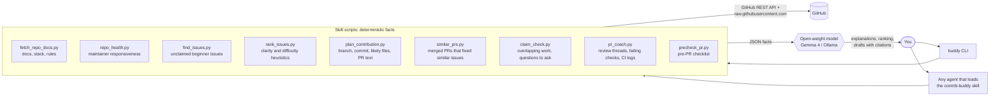

# contrib-bud

**From zero to your first pull request on any GitHub repo, with an open-weight model as your mentor.**

contrib-buddy reads a repo's README, CONTRIBUTING and templates, finds beginner issues nobody has claimed yet, and writes a step-by-step plan: commands, branch name, commit message and a PR description that uses the repo's own template. It ships two ways: as an **[Agent Skill](https://agentskills.io)** that any compatible agent can load, and as a **`buddy` CLI** powered by **Gemma 4** (or any local model via Ollama).

> It only advises and drafts. It never opens PRs, posts comments or pushes code. You do.

## Demo

<!-- TODO: replace with a 30-second GIF (e.g. recorded with vhs or asciinema) -->
`[ 30-second demo GIF goes here ]`. Until then, see [`demo/sample-output.txt`](demo/sample-output.txt) and [`demo/sample-plan.md`](demo/sample-plan.md).

## Quickstart

```bash
git clone https://github.com/YOUR-USER/contrib-buddy && cd contrib-buddy && pip install -e .
export GEMINI_API_KEY=your-key        # free at https://aistudio.google.com/apikey
buddy analyze mermaid-js/mermaid      # then: buddy issues <repo>, buddy plan <issue-url>
```

No key? Use `BUDDY_PROVIDER=ollama` (local, offline) or add `--no-ai` to see the facts only. If `buddy` is not on your PATH, use `python -m buddy`.

### Prefer a browser?

```bash
buddy web        # or double-click start-web.bat on Windows
```

This opens a local page at http://127.0.0.1:8765. Paste a repo link to see how to contribute and which issues are free. Click an issue to get a plan you can copy or download. You can also paste an issue link directly. It runs only on your machine, and your keys stay in `.env`.

## How it works



1. **Scripts gather facts.** Every repo fact (commands, rules, issues, files) comes from GitHub data, and each one carries its source file.
2. **The model does the language work.** It explains guidelines in plain English, ranks and explains issues, and drafts the approach and PR text. Prompts ([`buddy/prompts/`](buddy/prompts/)) require it to cite `[CONTRIBUTING.md]`, `[#123]` and the like, and to say "not found" instead of guessing. In the web chat, every citation is then **checked automatically** (see below).
3. **Structured output is checked.** Ranking and plan responses are JSON, validated against the real issue numbers and retried once. If they're still invalid, the CLI falls back to the heuristic ranking.

| Command | Facts (scripts) | Model's job |
|---|---|---|
| `buddy analyze <owner/repo>` | README, CONTRIBUTING, templates, stack, test/lint commands, rules, plus a **repo health** badge (Welcoming / Slow / Inactive) | Plain-English "how to contribute here", leading with health warnings |
| `buddy issues <owner/repo>` | Beginner-labelled issues minus assigned / linked-PR / recently claimed; heuristic scores | Rank, explain each issue, recommend one |
| `buddy plan <issue-url>` | Branch name, setup/test commands, **similar merged PRs** (files, size, review), likely files, commit style, PR template | Issue-specific approach, PR summary, claim comment with issue-specific questions |
| `buddy check` | Diff size, commit style, DCO, issue link, PR template, runs lint/tests | Explain each failure and how to fix it |
| `buddy coach [<pr-url>] [--text log.txt]` | Review threads, reviewer verdicts, failing checks with annotations and logs, parsed errors, conflicts | Explain what reviewers and CI want, the fix for each, and a reply draft |

### Repo health: is this repo worth my time?

`analyze` starts with a **Welcoming / Slow / Inactive** badge so you don't spend weeks on a repo whose maintainers never respond. [`repo_health.py`](backend/contrib-buddy/scripts/repo_health.py) checks:

| Signal | Good | Bad |
|---|---|---|
| Last commit on the default branch | ≤ 30 days | > 180 days |
| Median time to first response on outside contributors' PRs (6 PRs at least 14 days old; an unanswered one counts as its age) | ≤ 3 days | > 14 days |
| Share of recently closed outside PRs that were merged | ≥ 50% | < 25% |
| Open PRs untouched for 30+ days | ≤ 30% | > 60% |
| Stale bot (`.github/stale.yml` or `actions/stale`) | shown as a tip: reply quickly or your PR may be auto-closed | |

The verdict is **Inactive** if the repo is archived, hasn't had a commit in 6 months, or is bad at both responding and merging. It is **Welcoming** if the last commit is recent, nothing is bad, and responses or merges are good. Otherwise it is **Slow**. If there are too few outside PRs to judge, it says so instead of guessing.

"Outside contributors" means anyone who isn't an owner, member or collaborator, with bots excluded. GitHub relabels a first-timer as a regular contributor once their PR is merged, so counting only first-timers would hide every merged first PR.

### Verified citations in chat

Chat answers cite their sources, like `[src/app.py:12-40]`, `[README.md]`, `[#123]` or `[comment by @name]`. [`buddy/citations.py`](backend/buddy/citations.py) checks each one against the repo the chat indexed:

- **The file and lines exist.** Paths can be shortened when only one file matches (`app.py` means `src/app.py`).
- **The claim matches what's there.** The sentence (or clause) citing the lines must share enough words with them, allowing a few lines of slack. Any `` `quoted code` `` or code block must appear in them verbatim.
- **Issues and comments were in the data the model had.** In issue chat, `[#n]` must be that issue or one of its similar issues and PRs, and `@name` must have commented.

Each citation becomes a chip linking to the exact lines on GitHub: **✓ verified**, **? couldn't confirm** (the source exists but doesn't seem to say that), or **✗ not found**. Under each answer, a short report lists the flagged citations and why. When the claim matches other lines in the same file, the report points there instead. Commands contrib-buddy derived from a file (such as `uv run pytest` from `pyproject.toml`) count as that file's content.

This is word and code matching, not understanding: a verified citation means the source plausibly backs the sentence, not that the sentence is right.

### Pre-claim safety check

Before `plan` suggests claiming an issue, [`claim_check.py`](backend/contrib-buddy/scripts/claim_check.py) looks for anyone already on it, even without an explicit link:

- **Open PRs that mention the issue**, including PRs from forks.
- **Open PRs that look like the same work**: they share the issue's keywords and change the files this fix likely touches. A PR that only has a similar title counts too, if it was updated recently. Words that appear in most PR titles ("diagram" in a diagramming tool) are ignored.
- **Assignees and "I'll take this" comments of any age.** Quoted text in replies is ignored.
- **Whether a maintainer has replied, and whether the issue is vague**: no reproduction steps, no expected result, or labels like `needs triage`.

The verdict is **🔒 Already closed**, **🛑 Someone may be on it** (assigned, an active PR, or a claim in the last 14 days), **✋ Ask first** (an older claim, a possibly related PR, or a vague issue) or **✅ Looks free**. The claim comment changes to match. When someone may be on it, it becomes a polite check-in instead of a claim. Otherwise it lists questions to ask the maintainer first, such as "@dev offered to work on this 120 days ago. Are they still on it?" or "Could you share the steps to reproduce it?". When a model is configured, it rewords these questions for the specific issue.

### Learn from similar merged PRs

For the chosen issue, `plan` finds closed issues like it (keywords from the title, then shared labels) and the merged PRs that fixed them ([`similar_prs.py`](backend/contrib-buddy/scripts/similar_prs.py)). It shows which files each PR touched, how big it was (+/- lines, files changed), how long it took to merge, and how reviewers responded (number of reviews and requests for changes). Files those PRs changed come first in **Likely files**, ahead of keyword matches on file paths. Large PRs (30+ files) are flagged and left out of that list.

The fixing PR is found from the issue's timeline: a merged PR that cross-referenced the issue, or else the PR that contains the commit that closed it.

### PR coach: after you open the PR

Many first PRs stall after the first review. Paste a PR link (in the main box, the **🩺 PR coach** tab or at the end of a plan), a reviewer's comments, or the log of a failing check:

- **From a PR link**, [`pr_coach.py`](backend/contrib-buddy/scripts/pr_coach.py) collects:
  - open review threads, each with its file, line, the diff around it and every reply, and whether the reviewer is waiting on you;
  - each reviewer's latest verdict;
  - merge conflicts;
  - failed checks, with their annotations and, when `GITHUB_TOKEN` is set, an excerpt of the failed job's log. GitHub only serves logs to authenticated requests.
- **From pasted text**, it pulls the error lines out of logs from pytest, ruff/flake8, eslint, tsc, mypy, black/prettier, jest, Go, Rust, npm and GitHub Actions. It sorts them into kinds: lint, format, type, test, build, DCO, CLA, changelog or commit message.
- **Each kind gets a concrete fix, even without a model.** It uses the tool's own fixer for the files named (`ruff check --fix src/x.py`), the exact failing test (`pytest tests/test_x.py::test_y -x`), or `git rebase --signoff` for a missing DCO, followed by the repo's documented command to check again.
- **The model then explains each request in plain English**: what a "nit" is, whether it blocks the merge, and when a failure looks flaky and worth asking a maintainer to re-run. It suggests fixes with citations into the PR's own code (the contributor's branch is indexed, not `main`), checked like chat citations. It also drafts a polite reply.

You make the changes, push and post the reply yourself.

## Agent skill vs. CLI

- **As an Agent Skill:** copy or symlink [`contrib-buddy/`](contrib-buddy/) into your agent's skills directory. The agent reads [`SKILL.md`](contrib-buddy/SKILL.md), runs the scripts for facts and does the explaining itself. The skill follows the [Agent Skills specification](https://agentskills.io/specification) and CI validates it with `skills-ref`.
- **As a CLI:** `buddy` runs the same scripts and uses an **open-weight** model for the language work, with no proprietary agent runtime required.

## Open models used, and why

| Provider | Default model | Why |
|---|---|---|
| `gemma` (default) | `gemma-4-26b-a4b-it` via the Gemini API | Gemma 4 is open-weight. The 26B MoE variant is fast and good at following JSON instructions, and the free API tier means no GPU is needed. |
| `ollama` | `gemma4` (any Ollama model works, e.g. `qwen3`, `llama3.3`) | Fully local and offline. Your data never leaves your machine. |

The same weights run on both paths, so a demo on the hosted API reproduces locally.

## Configuration

| Variable | Default | Purpose |
|---|---|---|
| `BUDDY_PROVIDER` | `gemma` | `gemma` or `ollama` |
| `GEMINI_API_KEY` | – | Required for `gemma` |
| `BUDDY_MODEL` | `gemma-4-26b-a4b-it` / `gemma4` | Override the model (e.g. `gemma-4-31b-it`) |
| `OLLAMA_HOST` | `http://localhost:11434` | Ollama server URL |
| `GITHUB_TOKEN` | – | Optional; raises the GitHub limit from 60 to 5000 requests/hour (no scopes needed) |
| `CONTRIB_BUDDY_NO_CACHE` | – | Set to disable the 15-minute GitHub response cache |

Variables can also go in a `.env` file (see [`.env.example`](.env.example)).

## Limitations

- **Heuristics, not understanding.** "Likely files" come from PRs that fixed similar issues when there are any, and otherwise from keyword matching over file paths, not code search. Similar issues are found by keyword search, so they can miss or mismatch. The clarity/difficulty scores are rough. The model refines them, but always read the code yourself.
- **Claim detection** reads English comments only (the issue list uses the last 14 days; the pre-claim check reads every comment). Linked PRs are detected through GitHub search's `-linked:pr` qualifier. "A maintainer has replied" relies on GitHub's author association, which shows members who keep their organisation membership private as ordinary contributors.
- **Rule extraction** is pattern-based (DCO, CLA, Conventional Commits, issue linking…). Unusual wording can be missed, so skim CONTRIBUTING anyway.
- **Rate limits:** without `GITHUB_TOKEN`, one `analyze` + `issues` + `plan` run uses roughly 20–30 of your 60 requests/hour (the health check accounts for about 11; `fetch_repo_docs.py --no-health` skips it). `plan` adds about 20–40 calls (up to 8 of them searches) to find similar merged PRs, so set `GITHUB_TOKEN` if you plan more than one issue an hour.
- **Health is a sample.** It reads the latest 100 PRs and 6 PR timelines, so a quiet month or a Hacktoberfest spam wave can skew it. Use it to decide where to look first, not as a final judgment.
- Model output can still be wrong despite the citations. contrib-buddy drafts; you review.
- **Hacktoberfest 2026** no longer counts PRs toward rewards ([hacktoberfest.com](https://hacktoberfest.com)). This tool is about real, useful contributions, not PR counts.

## Roadmap

- [ ] GitHub code search for "likely files" when a token is present
- [ ] `buddy respond <pr-url>`: help interpret review comments
- [ ] Non-English claim detection
- [ ] GitLab / Codeberg support
- [ ] Cache issue comments between `issues` and `plan`

Good first issues for *this* repo are listed in [CONTRIBUTING.md](CONTRIBUTING.md#good-first-issues).

## Development

```bash
pip install -e ".[dev]"
pytest -q && ruff check .
```

## License

[MIT](LICENSE)
